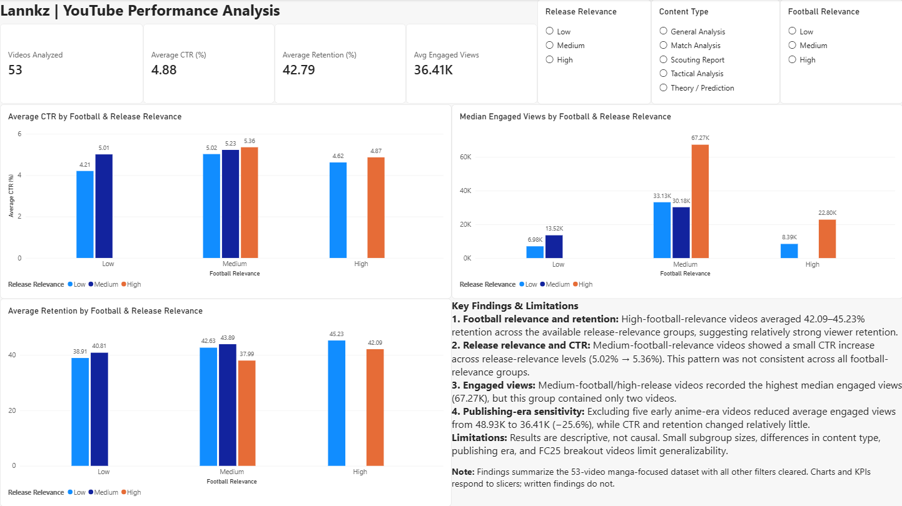
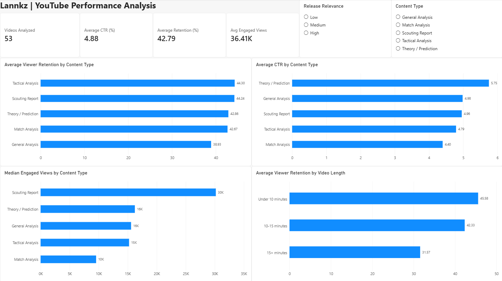
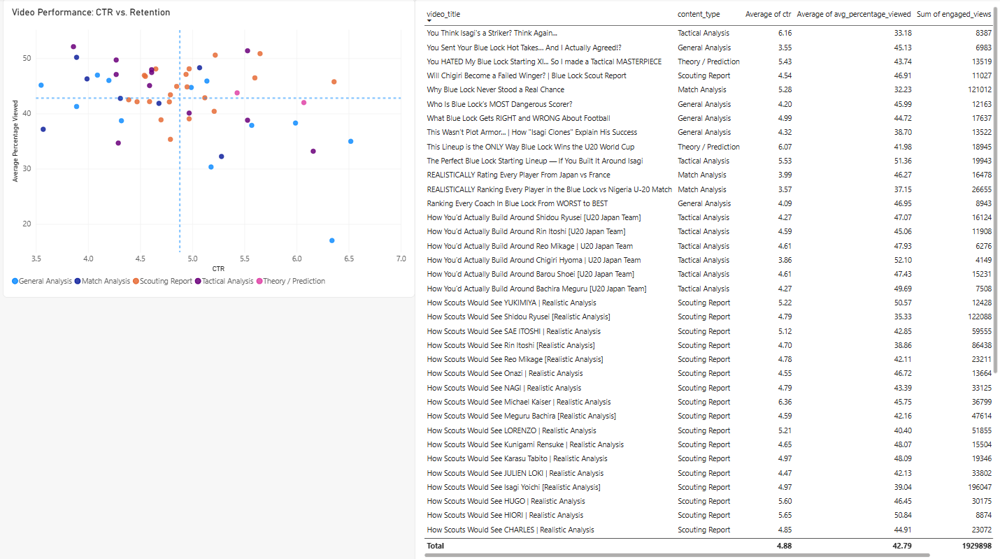

# Lannkz YouTube Content Performance Analysis

## Project Overview

An end-to-end analysis of 58 YouTube videos from **Lannkz**, a Blue Lock tactical-analysis channel, using Python, SQLite, and Power BI.

The project investigates the following research question:

**How are football relevance and release relevance associated with click-through rate (CTR), viewer retention, and engaged views?**

The analysis uses 58 historical videos, with **53 manga-focused videos forming the primary analytical dataset**. The remaining five videos belong to an earlier anime-focused content period and are retained for historical and sensitivity comparisons.

The objective is to identify performance patterns, assess their reliability, and translate findings into practical content-strategy recommendations.

## Power BI Dashboard




The interactive Power BI report contains three pages:

**1. Football & Release Relevance**

The main dashboard compares CTR, viewer retention, and median engaged views across football-relevance and release-relevance categories.

Includes interactive slicers, sample-size tooltips, and sensitivity filters.

**2. Supporting Analysis**

Explores performance differences by content type and video duration.

**3. Video Performance Explorer**

Uses a CTR-versus-retention scatter plot and an interactive video table to identify videos performing above or below channel benchmarks.

The dashboard defaults to the 53-video manga-focused dataset while retaining access to the complete historical data.

### Supporting Analysis



### Video Performance Explorer


## Tools Used

- **Python** — reproducible SQLite database creation
- **Excel / Power Query** — data preparation and cleaning
- **SQLite / SQL** — exploratory and comparative analysis
- **Power BI** — interactive visualization and reporting
- **GitHub** — project documentation and version control

## Project Workflow

1. Exported video performance metrics from YouTube Studio.
2. Cleaned and validated the dataset.
3. Categorized videos by content type, football relevance, and release relevance.
4. Created a SQLite database and developed SQL queries.
5. Analyzed CTR, retention, engaged views, and content characteristics.
6. Built a three-page interactive Power BI report.
7. Conducted sensitivity analyses to evaluate the influence of publishing era and unusually successful FC25 videos.
8. Developed evidence-based content recommendations.

## Key Findings

### 1. Football Relevance Is Associated With Relatively Strong Retention

In the manga-focused dataset, high-football-relevance videos averaged approximately **42–45% viewer retention** across the available release-relevance groups.

However, higher football relevance did not consistently correspond to higher CTR.

This suggests that football-focused analysis may be effective at retaining viewers who choose to watch, without necessarily attracting the broadest initial audience.

### 2. Release Relevance Does Not Consistently Predict Higher CTR

CTR patterns varied across football-relevance categories.

Among medium-football-relevance videos, CTR increased modestly across release-relevance levels, from approximately **5.02% to 5.36%**.

The relationship was not consistent across all categories, suggesting that topical timeliness alone is not a reliable predictor of stronger click-through performance.

### 3. Small Subgroups Limit Some Performance Comparisons

Medium-football/high-release videos recorded approximately **67.27K median engaged views**, the highest among the observed combinations.

However, this subgroup contained only **two videos**.

The finding is descriptive and should not be interpreted as evidence that this combination consistently produces the strongest performance.

### 4. Publishing Era Substantially Influences Viewership Benchmarks

Removing five early anime-era videos reduced average engaged views from approximately **48.93K to 36.41K**, a **25.6% decrease**.

Average CTR and retention changed comparatively little.

This indicates that the early publishing period disproportionately influences historical viewership averages and supports evaluating the channel's current manga-focused strategy separately.

### 5. FC25 Videos Influence Some Subgroup Results

Excluding two unusually successful FC25 videos reduced median engaged views for the medium-football/low-release group from approximately **33.13K to 24.02K**, a **27.5% decrease**.

This demonstrates the importance of checking whether findings remain stable when unusually successful videos are excluded.

## Recommendations

- **Use relevant benchmarks:** Evaluate current manga-focused uploads against comparable videos rather than relying exclusively on lifetime channel averages.
- **Maintain football-focused analysis:** Strong retention supports continuing tactical content, while experimenting with titles and thumbnails to improve audience reach.
- **Evaluate release relevance alongside topic appeal:** Do not assume a timely manga-related upload will automatically outperform an evergreen analysis.
- **Investigate exposure differences:** Compare impressions alongside CTR and retention before attributing low viewership to weak packaging or content quality.
- **Use subgroup findings cautiously:** Consider sample sizes and content-type differences before making production decisions.

## Limitations

- Observational dataset from one YouTube channel; findings are not causal.
- The primary analysis contains 53 manga-focused videos.
- Some relevance combinations contain only two or three videos.
- Football relevance, content type, and publishing era may overlap.
- Lifetime metrics are influenced by video age and exposure.
- Football and release relevance were manually categorized.
- YouTube's view-counting methodology changed in August 2026; engaged views were used for more consistent comparisons.
- CTR and retention alone cannot fully explain recommendation distribution or audience demand.

## Reproducing the Analysis

### Requirements

- Python 3.13 or later
- SQLite (DB Browser for SQLite is optional)
- Power BI Desktop to open the interactive dashboard

### 1. Create the database

From the project root directory, run:

```bash
python database/create_database.py
```

The script reads:

`data/processed/lannkz_videos_cleaned.csv`

And creates:

`database/lannkz_analytics.db`

The cleaned source dataset contains 58 videos and 18 columns.

### 2. Run the SQL analysis

Open `database/lannkz_analytics.db` using DB Browser for SQLite.

1. Select the **Execute SQL** tab.
2. Open `sql/analysis_queries.sql`.
3. Run the queries to reproduce the analysis.

The SQL script contains 13 queries covering channel performance, content-type comparisons, football and release relevance, viewer retention, correlations, and FC25 sensitivity analysis.

### 3. Explore the Power BI report

Open:

`dashboard/lannkz_youtube_dashboard.pbix`

The report includes interactive relevance comparisons, supporting analyses, and video-level performance exploration.

### 4. Review the findings

See `documentation/analysis_findings.md` for detailed interpretations, limitations, and recommendations.

## Project Deliverables

- Cleaned YouTube analytics dataset
- Reproducible Python database-creation script
- SQLite database and analytical SQL queries
- Three-page Power BI dashboard
- Documented findings and recommendations